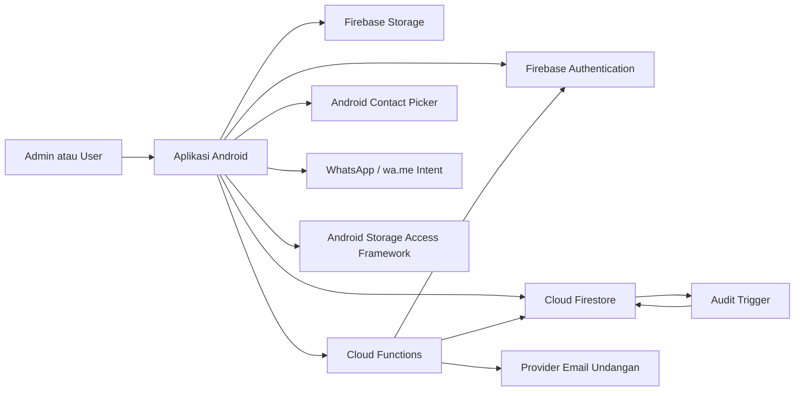
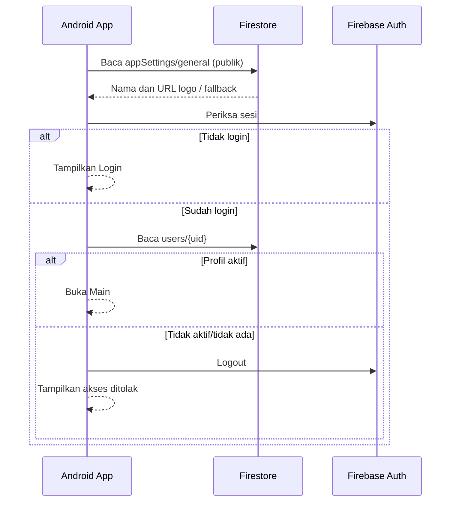
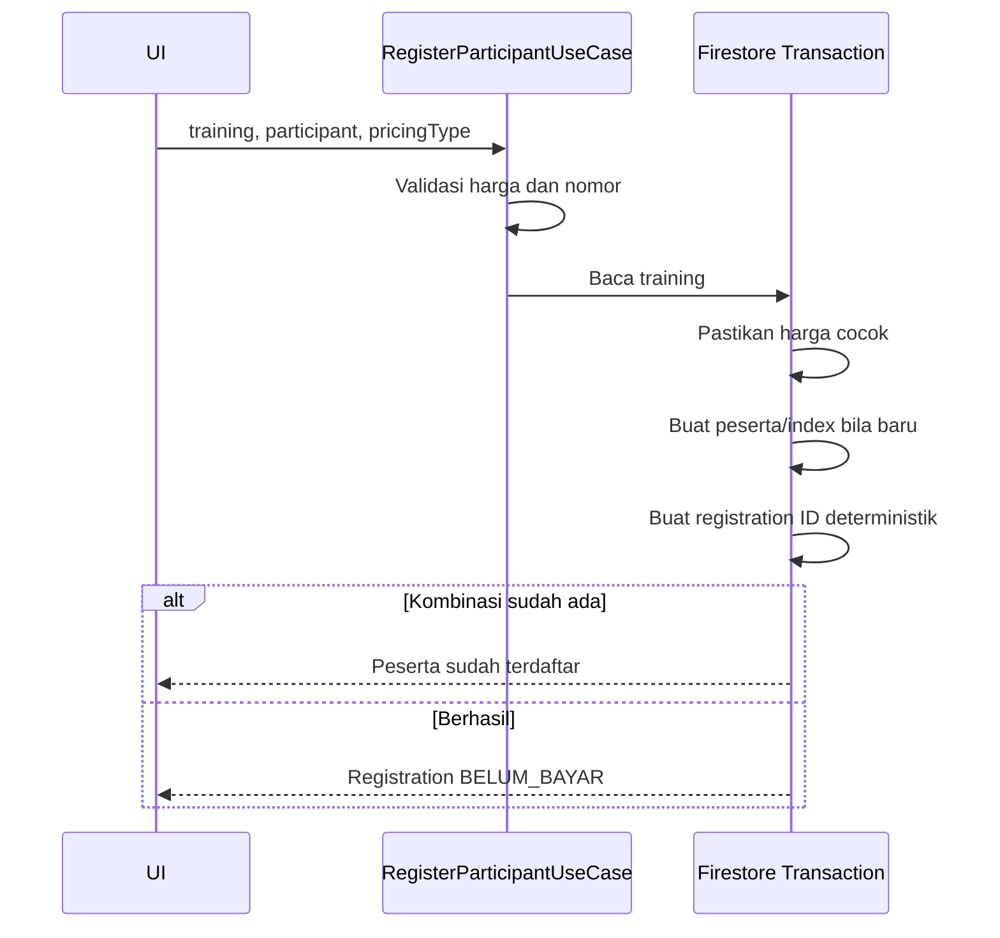

# Design Document — Aplikasi Manajemen Pelatihan Android

Dokumen ini menerjemahkan #[[file:requirements.md]] menjadi rancangan teknis yang dapat dikerjakan melalui #[[file:tasks.md]].

## 1. Ringkasan

E-Pelatihan adalah aplikasi Android untuk satu lembaga. Aplikasi menyimpan data operasional di Cloud Firestore, menggunakan Firebase Authentication untuk login, Firebase Storage untuk logo komunitas, serta Cloud Functions untuk operasi akun yang membutuhkan hak server. Aplikasi membuka WhatsApp dengan pesan yang telah disusun, tetapi tidak mengirim pesan secara otomatis.

Aplikasi menggunakan satu Android app module agar implementasi awal tetap sederhana. Pemisahan tanggung jawab dilakukan melalui package berdasarkan fitur dan lapisan, bukan melalui banyak Gradle module.

## 2. Asumsi desain

| Item | Nilai awal |
|---|---|
| Nama aplikasi | E-Pelatihan |
| Application ID | `com.harunmaul.epelatihan` |
| Minimum Android | Android 8 / API 26 |
| Bahasa antarmuka | Indonesia |
| Mata uang | IDR/Rupiah tanpa pecahan desimal |
| Lembaga | Satu lembaga |
| Orientasi utama | Portrait, tetap mendukung perubahan ukuran layar |
| Zona waktu | Zona waktu perangkat saat pelatihan dibuat, lalu disimpan pada data pelatihan |

Application ID harus dikonfirmasi sebelum aplikasi didaftarkan ke Firebase karena perubahan setelah integrasi akan memerlukan konfigurasi ulang.

## 3. Sasaran desain

- Menjaga aturan role pada UI, Firestore Security Rules, Storage Rules, dan backend.
- Menyimpan salinan harga pada pendaftaran agar laporan historis tidak berubah.
- Memungkinkan sinkronisasi data antar-HP dengan status offline/pending yang jelas.
- Menjaga layar login tetap dapat memuat branding sebelum autentikasi.
- Menghindari penyimpanan password, token server, atau secret di aplikasi.
- Menggunakan komponen Android standar untuk kontak, penyimpanan hasil ekspor, dan pembukaan WhatsApp.
- Menjaga implementasi versi awal sederhana tanpa menghalangi pengembangan berikutnya.

## 4. Arsitektur sistem



### Tanggung jawab komponen

| Komponen | Tanggung jawab |
|---|---|
| Android app | UI, validasi awal, akses data, kontak, WhatsApp, laporan, ekspor |
| Firebase Authentication | Login email/password, sesi, reset password |
| Cloud Firestore | Pengguna, pelatihan, peserta, pendaftaran, branding, log |
| Firebase Storage | Berkas logo komunitas |
| Cloud Functions | Undangan pengguna, custom claims, bootstrap Admin, audit server |
| Email provider | Mengirim tautan penetapan password |
| Contact Picker | Memberikan satu kontak yang dipilih pengguna |
| WhatsApp intent | Membuka percakapan dengan pesan siap kirim |
| Storage Access Framework | Memilih lokasi tujuan PDF/XLSX |

## 5. Teknologi dan pola implementasi

### Android

- Kotlin.
- Jetpack Compose dan Material 3.
- Single-activity dengan Navigation Compose.
- ViewModel dan `StateFlow` untuk state layar.
- Coroutines untuk operasi asinkron.
- Hilt untuk dependency injection.
- Firebase Android SDK melalui Firebase BoM.
- Coil untuk pemuatan dan cache logo.
- `java.time` untuk tanggal, jam, dan zona waktu karena minimum API 26.
- `PdfDocument` Android untuk ekspor PDF.
- Open XML minimal menggunakan `ZipOutputStream` untuk ekspor XLSX agar tidak menambah library spreadsheet besar.

### Backend

- Firebase Cloud Functions dengan TypeScript.
- Firebase Admin SDK.
- Secret Manager/environment configuration untuk credential provider email.
- Firestore dan Storage Rules disimpan serta ditinjau bersama source code.

### Pola arsitektur

```text
Compose Screen
    ↓ event             ↑ UiState
ViewModel
    ↓ use case          ↑ result/domain error
Use Case
    ↓ repository        ↑ domain model
Repository interface
    ↓
Firebase/Android implementation
```

UI tidak mengakses Firebase SDK secara langsung. Domain tidak bergantung pada Compose atau Firebase.

## 6. Struktur repository

```text
E-Pelatihan/
├── app/
│   └── src/main/java/com/harunmaul/epelatihan/
│       ├── App.kt
│       ├── MainActivity.kt
│       ├── core/
│       │   ├── auth/
│       │   ├── common/
│       │   ├── designsystem/
│       │   ├── navigation/
│       │   ├── validation/
│       │   └── util/
│       ├── data/
│       │   ├── firebase/
│       │   ├── mapper/
│       │   └── repository/
│       ├── domain/
│       │   ├── model/
│       │   ├── repository/
│       │   └── usecase/
│       └── feature/
│           ├── auth/
│           ├── training/
│           ├── participant/
│           ├── registration/
│           ├── report/
│           ├── usermanagement/
│           └── settings/
├── functions/
│   ├── src/
│   │   ├── auth/
│   │   ├── audit/
│   │   └── index.ts
│   └── package.json
├── firestore.rules
├── firestore.indexes.json
├── storage.rules
├── firebase.json
└── .kiro/specs/manajemen-pelatihan/
    ├── requirements.md
    ├── design.md
    └── tasks.md
```

## 7. Navigasi dan rancangan layar

### 7.1 Graph autentikasi

```text
Splash/Bootstrap
├── Login
├── Lupa Password
└── Main (jika sesi dan profil valid)
```

`Splash/Bootstrap` memuat `appSettings/general`, memeriksa sesi Firebase, lalu memuat profil pengguna. Branding tidak bergantung pada status login.

### 7.2 Navigasi utama

Gunakan `NavigationBar` dengan tujuan utama:

- **Pelatihan**
- **Peserta**
- **Laporan**
- **Lainnya**

Menu **Lainnya** berisi:

- Pengguna, khusus Admin.
- Pengaturan, khusus Admin.
- Informasi akun.
- Logout.

### 7.3 Daftar layar

| Layar | Admin | User | Catatan |
|---|---:|---:|---|
| Login | Ya | Ya | Menampilkan logo dan nama komunitas |
| Daftar pelatihan | Ya | Ya | Filter status/tanggal dapat ditambahkan tanpa mengubah model |
| Tambah pelatihan | Ya | Ya | Setelah disimpan, User tidak dapat mengubah |
| Detail pelatihan | Ya | Ya | Memuat daftar pendaftaran |
| Ubah/arsip pelatihan | Ya | Tidak | Tidak melakukan hard delete jika sudah dipakai |
| Daftar peserta | Ya | Ya | Pencarian nama/nomor |
| Tambah peserta | Ya | Ya | Manual atau Contact Picker |
| Ubah/arsip peserta | Ya | Tidak | Menjaga referensi pendaftaran |
| Tambah pendaftaran | Ya | Ya | Pilihan harga manual jika early bird aktif |
| Ubah pendaftaran | Ya | Tidak | Termasuk koreksi jenis harga |
| Ubah pembayaran | Ya | Tidak | Konfirmasi sebelum simpan |
| Laporan | Ya | Ya | Bulan/tahun, ringkasan, rincian |
| Kelola pengguna | Ya | Tidak | Undang, role, status aktif |
| Pengaturan | Ya | Tidak | Nama komunitas dan logo |

### 7.4 Prinsip UI

- Tombol simpan dinonaktifkan saat form tidak valid atau operasi sedang berlangsung.
- Operasi tidak dianggap berhasil sebelum backend mengonfirmasi, kecuali write offline yang diberi label **Menunggu sinkronisasi**.
- Hak akses yang tidak dimiliki tidak ditampilkan di UI, tetapi aturan keamanan tetap menjadi pengaman utama.
- Nominal ditampilkan dalam format Rupiah, tetapi disimpan sebagai `Long`.
- Pesan error menggunakan bahasa Indonesia dan memberikan tindakan yang dapat dilakukan pengguna.
- Dialog konfirmasi digunakan untuk perubahan pembayaran, role, status akun, dan pengarsipan.

## 8. Model domain

```kotlin
enum class UserRole { ADMIN, USER }
enum class MeetingMethod { ONLINE, OFFLINE }
enum class PricingScheme { NORMAL_ONLY, EARLY_BIRD_AND_NORMAL }
enum class PricingType { EARLY_BIRD, NORMAL }
enum class PaymentStatus { BELUM_BAYAR, LUNAS }
enum class TrainingLifecycle { ACTIVE, ARCHIVED }
```

Status tampilan pelatihan diturunkan dari waktu dan lifecycle:

- `DIARSIPKAN` jika lifecycle `ARCHIVED`.
- `AKAN_DATANG` jika waktu sekarang sebelum jam mulai.
- `BERLANGSUNG` jika berada antara jam mulai dan selesai.
- `SELESAI` jika sudah melewati jam selesai.

Pendekatan ini menghindari job terjadwal hanya untuk mengganti status pelatihan.

### Aturan tanggal dan waktu

- UI menerima tanggal, jam mulai, dan jam selesai.
- Aplikasi menyimpan `startAt` dan `endAt` sebagai Firestore Timestamp.
- Aplikasi juga menyimpan `timeZoneId`, misalnya `Asia/Jakarta`, agar tampilan konsisten antarperangkat.
- Validasi memastikan `endAt > startAt`.
- Filter laporan mengubah bulan lokal menjadi rentang timestamp `[awalBulan, awalBulanBerikutnya)`.

### Aturan uang

- IDR disimpan sebagai `Long`, misalnya `400000`, bukan `400000.00`.
- `earlyBirdPrice < normalPrice`.
- Nilai tidak boleh negatif.
- `Registration.priceAmount` tidak dihitung ulang saat laporan dibuka.

## 9. Desain data Firestore

Semua nama field menggunakan `camelCase`. Timestamp berasal dari server bila field mewakili waktu mutasi.

### 9.1 `appSettings/general`

Dokumen ini dapat dibaca tanpa login dan tidak boleh berisi data sensitif.

```json
{
  "communityName": "Komunitas Pelatihan Indonesia",
  "logoUrl": "https://...",
  "logoStoragePath": "branding/logo/uuid.webp",
  "schemaVersion": 1,
  "updatedBy": "uid-admin",
  "updatedAt": "server timestamp"
}
```

Hanya Admin dapat menulis. Jika dokumen belum ada, aplikasi menggunakan nama `E-Pelatihan` dan logo bawaan lokal.

### 9.2 `users/{uid}`

```json
{
  "displayName": "Nama Pengguna",
  "email": "user@example.com",
  "role": "ADMIN",
  "active": true,
  "invitationStatus": "INVITED",
  "createdBy": "uid-admin",
  "createdAt": "server timestamp",
  "updatedBy": "uid-admin",
  "updatedAt": "server timestamp"
}
```

`invitationStatus` bernilai `INVITED` atau `ACTIVE`. Dokumen ID harus sama dengan Firebase Auth UID.

### 9.3 `trainings/{trainingId}`

```json
{
  "name": "Pelatihan Android",
  "description": "",
  "startAt": "timestamp",
  "endAt": "timestamp",
  "timeZoneId": "Asia/Jakarta",
  "speaker": "Nama Pemateri",
  "meetingMethod": "ONLINE",
  "zoomUrl": "https://...",
  "location": null,
  "recordingUrl": null,
  "materialUrl": "https://...",
  "pricingScheme": "EARLY_BIRD_AND_NORMAL",
  "normalPrice": 500000,
  "earlyBirdPrice": 400000,
  "lifecycle": "ACTIVE",
  "createdBy": "uid",
  "createdAt": "server timestamp",
  "updatedBy": "uid",
  "updatedAt": "server timestamp"
}
```

Aturan field kondisional:

- `ONLINE`: `zoomUrl` wajib dan `location` null/kosong.
- `OFFLINE`: `location` wajib dan `zoomUrl` null/kosong.
- `NORMAL_ONLY`: `earlyBirdPrice` null.
- `EARLY_BIRD_AND_NORMAL`: kedua harga wajib dan early bird lebih kecil.

### 9.4 `participants/{participantId}`

```json
{
  "name": "Andi",
  "nameSort": "andi",
  "phoneDisplay": "0812-3456-789",
  "phoneNormalized": "628123456789",
  "email": null,
  "notes": null,
  "active": true,
  "createdBy": "uid",
  "createdAt": "server timestamp",
  "updatedBy": "uid",
  "updatedAt": "server timestamp"
}
```

Nomor Indonesia dinormalisasi ke digit internasional tanpa `+`, spasi, atau tanda baca. Nomor negara lain yang sudah memiliki kode negara dipertahankan dalam format digit internasional.

### 9.5 `participantPhoneIndex/{phoneKey}`

```json
{
  "participantId": "participant-id",
  "phoneNormalized": "628123456789",
  "createdAt": "server timestamp"
}
```

`phoneKey` adalah hash stabil dari nomor normal. Dokumen dibuat dalam transaksi yang sama dengan peserta untuk mencegah duplikasi nomor akibat dua perangkat menyimpan bersamaan.

### 9.6 `registrations/{registrationId}`

Gunakan ID deterministik dari `trainingId` dan `participantId` agar kombinasi yang sama tidak dapat dibuat dua kali.

```json
{
  "trainingId": "training-id",
  "participantId": "participant-id",
  "pricingType": "EARLY_BIRD",
  "priceAmount": 400000,
  "paymentStatus": "BELUM_BAYAR",
  "paidAt": null,
  "paidBy": null,
  "createdBy": "uid",
  "createdAt": "server timestamp",
  "updatedBy": "uid",
  "updatedAt": "server timestamp"
}
```

Saat create, Security Rules membaca master pelatihan dan memastikan:

- `NORMAL_ONLY` hanya menerima `NORMAL` dan `priceAmount == normalPrice`.
- Early bird menerima `EARLY_BIRD` atau `NORMAL` dengan nominal yang cocok.
- User tidak dapat mengirim nominal bebas.
- Status awal selalu `BELUM_BAYAR`.

### 9.7 `whatsappOpenLogs/{logId}`

```json
{
  "registrationId": "registration-id",
  "recipientPhone": "628123456789",
  "messageSnapshot": "Halo ...",
  "openedBy": "uid",
  "openedAt": "server timestamp"
}
```

Nama aksi selalu menjelaskan bahwa aplikasi hanya membuka WhatsApp, bukan memastikan pesan terkirim.

### 9.8 `auditLogs/{eventId}`

```json
{
  "actorId": "uid",
  "action": "UPDATE_PAYMENT_STATUS",
  "entityType": "REGISTRATION",
  "entityId": "registration-id",
  "before": {},
  "after": {},
  "createdAt": "server timestamp"
}
```

Klien tidak boleh membuat, mengubah, atau menghapus audit log. Cloud Function menulis log dari perubahan yang sudah diterima Firestore. Gunakan event ID sebagai document ID agar retry trigger tidak menggandakan log.

## 10. Query dan index

### Daftar pelatihan

- Query `lifecycle == ACTIVE`, urut `startAt`.
- Pelatihan arsip dimuat melalui filter terpisah untuk Admin.

### Daftar peserta

- Query `active == true`, urut `nameSort`.
- Pencarian sederhana dilakukan pada data halaman yang telah dimuat; optimasi pencarian server dapat ditambahkan jika volume tumbuh.

### Pendaftaran

- Query `trainingId == selectedTrainingId`, urut `createdAt`.
- Detail peserta dimuat melalui cache repository berdasarkan `participantId`.

### Laporan bulanan

1. Query pelatihan dengan `startAt >= awalBulan` dan `startAt < awalBulanBerikutnya`.
2. Untuk setiap pelatihan hasil query, ambil pendaftaran dengan `trainingId == id`.
3. Gabungkan hasil di domain layer menggunakan `Registration.priceAmount`.

Pendekatan beberapa query dipilih karena jumlah pelatihan bulanan pada satu lembaga diperkirakan kecil dan tidak membutuhkan denormalisasi tanggal pelatihan ke pendaftaran. Jika volume menjadi besar, versi berikutnya dapat menambah materialized report summary di backend.

Index awal:

- `trainings`: `lifecycle ASC, startAt ASC`.
- `registrations`: `trainingId ASC, createdAt ASC`.
- `users`: `active ASC, displayName ASC`.
- `participants`: `active ASC, nameSort ASC`.

Index final mengikuti error link yang diberikan emulator/Firestore saat query implementasi diverifikasi.

## 11. Repository dan use case

### Repository interfaces

```kotlin
interface AuthRepository
interface AppSettingsRepository
interface UserRepository
interface TrainingRepository
interface ParticipantRepository
interface RegistrationRepository
interface ReportRepository
interface WhatsAppLauncher
interface ReportExporter
```

### Use case utama

- `ObserveSessionUseCase`
- `LoginUseCase`
- `InviteUserUseCase`
- `ObserveAppSettingsUseCase`
- `UpdateAppSettingsUseCase`
- `CreateTrainingUseCase`
- `UpdateTrainingUseCase`
- `CreateParticipantUseCase`
- `RegisterParticipantUseCase`
- `UpdateRegistrationPriceUseCase`
- `UpdatePaymentStatusUseCase`
- `BuildWhatsAppMessageUseCase`
- `OpenWhatsAppUseCase`
- `GenerateMonthlyReportUseCase`
- `ExportReportPdfUseCase`
- `ExportReportXlsxUseCase`

Use case menerapkan aturan domain kembali meskipun Rules juga memvalidasi. Validasi ganda memberikan pesan cepat pada pengguna dan perlindungan server terhadap klien yang dimodifikasi.

## 12. Alur penting

### 12.1 Login dan bootstrap



### 12.2 Undangan pengguna

1. Admin mengisi nama, email, dan role.
2. Aplikasi memanggil callable function `inviteUser`.
3. Function memvalidasi token, custom claim Admin, dan profil Admin aktif.
4. Function membuat Firebase Auth user tanpa membagikan password.
5. Function mengatur custom claims role/status.
6. Function membuat `users/{uid}`.
7. Function menghasilkan tautan penetapan/reset password.
8. Provider email mengirim tautan.
9. Function mengembalikan status sukses tanpa mengembalikan credential.

Jika pengiriman email gagal setelah akun dibuat, status tetap `INVITED` dan Admin dapat memilih **Kirim ulang undangan**.

### 12.3 Pendaftaran peserta



### 12.4 Perubahan pembayaran

1. Hanya Admin melihat aksi pembayaran.
2. Admin mengonfirmasi perubahan.
3. Update mengirim `paymentStatus`, `paidAt`, `paidBy`, `updatedBy`, dan `updatedAt`.
4. Rules memastikan pemanggil Admin aktif dan actor UID benar.
5. Audit trigger mencatat before/after.
6. UI menampilkan hasil setelah server mengonfirmasi atau status pending jika offline.

### 12.5 Penggantian logo

1. Admin memilih gambar melalui system picker.
2. Aplikasi memeriksa MIME type dan ukuran maksimal 2 MB.
3. Aplikasi menampilkan pratinjau.
4. Aplikasi mengunggah ke path unik `branding/logo/{uuid}.{ext}`.
5. Aplikasi menjalankan transaction pada `appSettings/general` untuk mengganti referensi.
6. Jika transaction gagal, aplikasi menghapus upload baru dan mempertahankan referensi lama.
7. Jika transaction berhasil, aplikasi mencoba menghapus logo lama.
8. Kegagalan menghapus logo lama dicatat untuk cleanup, tetapi tidak membatalkan branding baru.
9. Audit trigger mencatat perubahan settings.

Transaction menggunakan `updatedAt`/versi yang terakhir dibaca untuk mendeteksi dua Admin yang mengubah branding bersamaan.

### 12.6 WhatsApp manual

1. Aplikasi memeriksa pendaftaran berstatus `LUNAS`.
2. Aplikasi mengambil data peserta dan pelatihan terbaru.
3. `BuildWhatsAppMessageUseCase` membentuk teks Indonesia.
4. Nomor dan teks di-URL-encode.
5. Aplikasi membuka `https://wa.me/{phone}?text={message}` melalui `ACTION_VIEW`.
6. Setelah intent berhasil diluncurkan, aplikasi menulis `WhatsAppOpenLog`.
7. UI tidak menampilkan status “terkirim”.

Contoh template:

```text
Halo {namaPeserta},

Pembayaran Anda untuk {namaPelatihan} sudah tercatat lunas.

Tanggal: {tanggal}
Waktu: {jamMulai}–{jamSelesai}
Pemateri: {pemateri}
Metode: {Online/Offline}
{Zoom atau Lokasi}
{Link Rekaman jika tersedia}
{Link Materi jika tersedia}

Salam,
{namaKomunitas}
```

## 13. Desain laporan

### Model hasil agregasi

```kotlin
data class MonthlyReport(
    val month: YearMonth,
    val trainingCount: Int,
    val registrationCount: Int,
    val paidCount: Int,
    val unpaidCount: Int,
    val earlyBirdCount: Int,
    val normalCount: Int,
    val totalBilled: Long,
    val totalIncome: Long,
    val outstanding: Long,
    val trainings: List<TrainingReportRow>
)
```

### Rumus

```text
jumlahPendaftar = count(registrations)
jumlahLunas = count(paymentStatus == LUNAS)
jumlahBelumBayar = count(paymentStatus == BELUM_BAYAR)
totalTagihan = sum(priceAmount)
totalPemasukan = sum(priceAmount jika LUNAS)
sisaBelumDibayar = totalTagihan - totalPemasukan
```

### PDF

- Gunakan `PdfDocument`.
- Header memuat nama komunitas, logo jika tersedia, bulan laporan, dan waktu pembuatan.
- Ringkasan berada di halaman pertama.
- Rincian per pelatihan dapat berlanjut ke beberapa halaman.
- Footer memuat nomor halaman.

### XLSX

Implementasikan Open XML minimal melalui `ZipOutputStream` di balik interface `ReportExporter`.

- Sheet `Ringkasan` berisi metrik laporan.
- Sheet `Per Pelatihan` berisi nama pelatihan, tanggal, jumlah peserta, jumlah lunas, tagihan, pemasukan, dan sisa.
- Nilai uang ditulis sebagai angka dengan style format Rupiah, bukan string berformat.
- Semua isi teks melalui XML escaping.

File disimpan menggunakan `ACTION_CREATE_DOCUMENT`. URI hasil picker ditulis melalui `ContentResolver`; aplikasi tidak meminta izin penyimpanan umum.

## 14. Security design

### Sumber role

- Custom claims menyimpan `role` dan status akses untuk pemeriksaan Rules/Storage.
- `users/{uid}` menyimpan profil yang ditampilkan UI dan status aktif terkini.
- Backend menjaga claims dan dokumen profil tetap konsisten.
- Saat role/status berubah, backend memperbarui claims dan mencabut refresh token bila diperlukan.

### Ringkasan akses Firestore

| Resource | Public | User aktif | Admin aktif |
|---|---:|---:|---:|
| `appSettings/general` read | Ya | Ya | Ya |
| `appSettings/general` write | Tidak | Tidak | Ya |
| `users` read | Tidak | Profil sendiri/daftar terbatas sesuai kebutuhan | Ya |
| `users` write | Tidak | Tidak | Melalui backend |
| `trainings` read | Tidak | Ya | Ya |
| `trainings` create | Tidak | Ya | Ya |
| `trainings` update/archive | Tidak | Tidak | Ya |
| `participants` read/create | Tidak | Ya | Ya |
| `participants` update/archive | Tidak | Tidak | Ya |
| `registrations` read/create | Tidak | Ya | Ya |
| `registrations` update | Tidak | Tidak | Ya |
| `whatsappOpenLogs` create | Tidak | Ya, actor sendiri | Ya |
| `auditLogs` | Tidak | Tidak | Read Admin, write backend |

### Storage Rules

- Public hanya dapat `get` logo pada `branding/logo/**` agar login dapat menampilkannya.
- Public tidak dapat melakukan listing.
- Hanya Admin aktif yang dapat upload/delete.
- Upload wajib `image/png`, `image/jpeg`, atau `image/webp`.
- Ukuran upload maksimal 2 MB.
- Semua path lain ditolak.

### Validasi actor

Untuk write langsung dari Android:

- `createdBy == request.auth.uid` saat create.
- `updatedBy == request.auth.uid` saat update.
- Field `createdBy` dan `createdAt` immutable.
- User tidak dapat menyetel status awal selain `BELUM_BAYAR`.
- User tidak dapat mengubah field apa pun setelah pendaftaran dibuat.

### Secret

- Credential provider email berada di Secret Manager.
- Service account tidak disimpan di repository atau APK.
- `google-services.json` diperlakukan sebagai konfigurasi environment dan diperiksa sebelum diputuskan untuk disimpan; tidak ada secret backend di dalam source.
- Log tidak mencetak password, token, tautan reset lengkap, atau data kontak berlebihan.

## 15. Sinkronisasi dan kondisi offline

- Firestore offline persistence digunakan untuk cache data.
- Snapshot dengan `hasPendingWrites` ditampilkan sebagai **Menunggu sinkronisasi**.
- UI membedakan `Tersimpan`, `Menunggu sinkronisasi`, dan `Gagal`.
- Operasi Cloud Functions seperti undangan membutuhkan koneksi dan tidak diantrikan sebagai sukses.
- Penggantian logo membutuhkan koneksi karena melibatkan Storage dan transaction.
- Laporan dapat menggunakan cache yang tersedia, tetapi UI menampilkan waktu pembaruan terakhir dan indikator offline.
- Konflik edit rendah karena User tidak dapat mengubah data tersimpan. Untuk dua Admin, Firestore transaction/precondition digunakan pada perubahan yang memerlukan konsistensi.

## 16. Error handling

Gunakan domain error yang dapat dipetakan ke pesan UI:

```text
AuthenticationError
AuthorizationError
ValidationError
DuplicateParticipantError
DuplicateRegistrationError
NetworkError
StorageError
ExportError
UnknownError
```

Contoh pemetaan:

- `AuthorizationError` → “Anda tidak memiliki akses untuk melakukan tindakan ini.”
- `DuplicateRegistrationError` → “Peserta sudah terdaftar pada pelatihan ini.”
- `NetworkError` pada undangan → “Undangan belum dikirim. Periksa koneksi lalu coba lagi.”
- WhatsApp tidak tersedia → “WhatsApp tidak dapat dibuka pada perangkat ini.”

Error teknis lengkap hanya dicatat pada logger non-sensitif; UI menampilkan pesan yang dapat dipahami pengguna.

## 17. Backend functions

| Function | Trigger | Tujuan |
|---|---|---|
| `inviteUser` | Callable | Membuat akun, claims, profil, dan undangan |
| `resendInvitation` | Callable | Membuat dan mengirim ulang tautan |
| `updateUserAccess` | Callable | Mengubah role/aktif serta refresh token |
| `bootstrapFirstAdmin` | One-time/admin invocation | Membuat Admin pertama secara terbatas |
| `auditTrainingWrite` | Firestore trigger | Audit create/update/archive pelatihan |
| `auditRegistrationWrite` | Firestore trigger | Audit koreksi harga dan pembayaran |
| `auditUserWrite` | Firestore trigger | Audit role/status akun |
| `auditSettingsWrite` | Firestore trigger | Audit nama dan logo komunitas |

`bootstrapFirstAdmin` harus dinonaktifkan atau menolak semua request setelah Admin pertama ada.

## 18. Konfigurasi dan deployment

### Konfigurasi Android

- `google-services.json` dari Firebase project dengan application ID final.
- Nama aplikasi dan logo fallback sebagai Android resources.
- Build type `debug` dan `release`.
- Minification release dikonfigurasi setelah dependency final dipilih.

### Konfigurasi Firebase

- Authentication provider Email/Password aktif.
- Firestore database aktif pada region yang dipilih lembaga.
- Storage bucket aktif.
- Cloud Functions dan provider email terkonfigurasi.
- Firestore Rules, Storage Rules, dan indexes dideploy dari repository.
- App Check dapat diaktifkan setelah alur development stabil, sebelum distribusi produksi.

Cloud Functions dan pengiriman email mungkin membutuhkan aktivasi billing atau layanan pihak ketiga. Hal ini harus diperiksa saat Firebase project dibuat.

## 19. Keputusan dan trade-off

| Keputusan | Alasan | Konsekuensi |
|---|---|---|
| Firestore, bukan file Google Drive | Sinkronisasi, query, rules, concurrent writes | Membutuhkan Firebase project |
| Satu app module | Ukuran proyek awal dan tim kecil | Modularisasi Gradle dapat dilakukan nanti |
| Role dilindungi server | UI saja tidak cukup aman | Rules/functions lebih banyak |
| Harga disalin ke pendaftaran | Menjaga laporan historis | Data sedikit terduplikasi |
| Early bird dipilih manual | Sesuai proses bisnis | Pengguna harus memilih dengan benar |
| WhatsApp intent manual | Tidak membutuhkan Business API | Tidak ada status terkirim |
| Contact Picker | Privasi lebih baik | Pemilihan dilakukan satu kontak per aksi |
| Query laporan per pelatihan | Tidak memerlukan denormalisasi tanggal | Jumlah read bertambah sesuai jumlah pelatihan |
| PDF native dan XLSX Open XML minimal | Mengurangi dependency besar | Exporter XLSX perlu implementasi teliti |
| Branding publik read-only | Login dapat menampilkan logo sebelum auth | Logo dan nama komunitas memang bersifat publik |
| Arsip, bukan hard delete | Menjaga referensi dan laporan | Data tetap tersimpan |

## 20. Risiko dan mitigasi

| Risiko | Mitigasi |
|---|---|
| User memanipulasi harga dari klien | Rules membandingkan harga dengan master pelatihan |
| Role UI dimanipulasi | Rules, custom claims, dan callable function memvalidasi server-side |
| Akun nonaktif masih memegang token lama | Perbarui claims dan revoke refresh token |
| Dua perangkat mendaftarkan peserta yang sama | Phone index transaction dan registration ID deterministik |
| Logo baru gagal disimpan | Upload baru, transaction settings, baru hapus logo lama |
| Link Google Drive tidak dapat dibuka peserta | Validasi URL dan tampilkan pengingat izin berbagi sebelum simpan |
| WhatsApp dianggap sudah mengirim | Gunakan status/log `WHATSAPP_OPENED`, bukan `SENT` |
| Data laporan berubah setelah harga master diubah | Gunakan snapshot `Registration.priceAmount` |
| Laporan membaca cache lama | Tampilkan status offline dan waktu pembaruan |
| Ekspor XLSX rusak karena karakter khusus | XML escaping dan validasi dengan pembaca spreadsheet pada tahap penerimaan |

## 21. Traceability

| Requirement | Komponen utama |
|---|---|
| REQ-01 | AuthRepository, Login, bootstrap session |
| REQ-02 | User Management, Cloud Functions, email provider |
| REQ-03 | Training feature, TrainingRepository |
| REQ-04 | Pricing validation, training form |
| REQ-05 | Participant feature, Contact Picker, phone index |
| REQ-06 | Registration feature, transaction, price snapshot |
| REQ-07 | Admin payment action, Rules, audit trigger |
| REQ-08 | Message builder, WhatsAppLauncher, open log |
| REQ-09 | ReportRepository, monthly aggregation |
| REQ-10 | PDF/XLSX exporters, Storage Access Framework |
| REQ-11 | Firestore repositories, offline metadata |
| REQ-12 | Claims, Rules, Functions, audit logs |
| REQ-13 | AppSettingsRepository, Settings screen, Storage branding |

## 22. Urutan implementasi

Implementasi mengikuti #[[file:tasks.md]]:

1. Scaffold proyek dan dependency dasar.
2. Firebase serta model domain/data.
3. Authentication, bootstrap Admin, undangan, dan security rules.
4. Pelatihan, peserta, pendaftaran, dan pembayaran.
5. WhatsApp manual.
6. Laporan dan ekspor.
7. Pengaturan branding.
8. Sinkronisasi, audit, dan verifikasi penerimaan.
